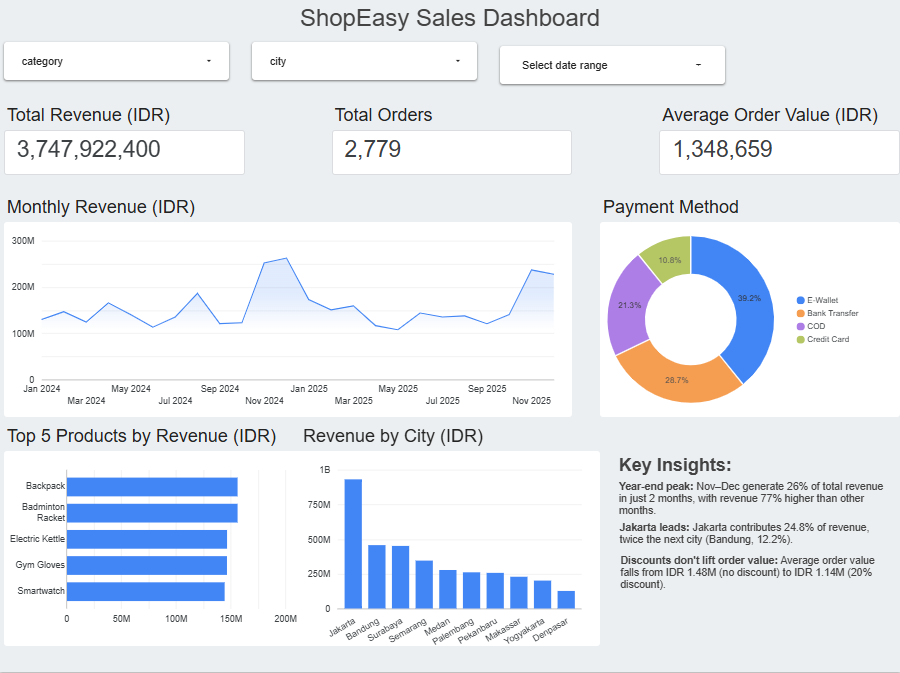

# ShopEasy Sales Analysis (2024–2025)

An end-to-end data analysis project on a synthetic e-commerce dataset: data cleaning, SQL analysis, visualization, and an interactive dashboard.

> **Note:** The dataset is synthetic (generated with Python) and created for portfolio purposes only.

## 🔗 Live Dashboard
**[View the interactive dashboard](https://lookerstudio.google.com/reporting/457467db-8daa-48ed-aa00-6aed2ea8e86f/page/YLEEG)**



## 🎯 Business Questions
1. How do sales change over time? Is there seasonality?
2. Which products, categories, and cities drive revenue?
3. How do customers prefer to pay?
4. Do discounts increase order value?

## 🛠️ Tools
- **Python** (pandas, matplotlib) in Google Colab: cleaning and visualization
- **SQL** (SQLite): business queries
- **Looker Studio**: interactive dashboard
- **Google Drive / Sheets**: data storage

## 📂 Dataset
| Table | Rows | Description |
|---|---|---|
| orders | 3,187 | Order date, product, quantity, discount, payment method, status |
| customers | 500 | City, gender, age, signup date |
| products | 40 | Product name, category, price (IDR) |

## 🧹 Data Cleaning
| Issue | Action |
|---|---|
| 39 duplicate order rows | Removed with `drop_duplicates()` |
| Inconsistent text (`e-wallet`, `cod`) | Standardized casing and labels |
| 30 missing order statuses | Filled with `Unknown` |
| 25 missing cities | Filled with `Unknown` |
| 5 outliers (quantity = 99) | Removed (kept quantity ≤ 10) |

## 📊 Key Findings
- **Total revenue:** IDR 3.75B from 2,779 completed orders (average order value: IDR 1.35M)
- **Year-end peak:** Nov–Dec generate 26% of revenue in 2 months, 77% higher than other months
- **Jakarta leads:** 24.8% of revenue, twice the next city (Bandung, 12.2%)
- **Balanced categories:** each category contributes 18.5%–21.8% of revenue
- **E-Wallet is preferred:** 39.2% of orders
- **Discounts don't lift order value:** average order value falls from IDR 1.48M (no discount) to IDR 1.14M (20% discount)
- **Flat growth:** 2025 revenue is 2.7% lower than 2024

## 💡 Recommendations
1. Prepare stock and campaigns ahead of Nov–Dec
2. Investigate the 2025 dip (e.g., new customer acquisition)
3. Expand marketing outside Jakarta
4. Reassess deep discounts, since they don't increase order value
5. Investigate causes of cancellations (7.3%) and returns (3.4%)

## 📁 Project Structure
```
shopeasy-sales-analysis/
├── README.md
├── data/
│   ├── raw/
│   │   ├── orders.csv
│   │   ├── customers.csv
│   │   └── products.csv
│   └── clean/
│       ├── orders_clean.csv
│       ├── customers_clean.csv
│       └── dashboard_data.csv
├── scripts/
│   └── generate_data.py
├── notebook/
│   └── shopeasy_analysis.ipynb
└── images/
    ├── dashboard.png
    ├── monthly_revenue.png
    ├── top_products.png
    └── city_revenue.png
```

## 👤 Author
**Dhiki Pernando** · [LinkedIn](https://www.linkedin.com/in/dhiki-pernando/) · [GitHub](https://github.com/dhikiper)
